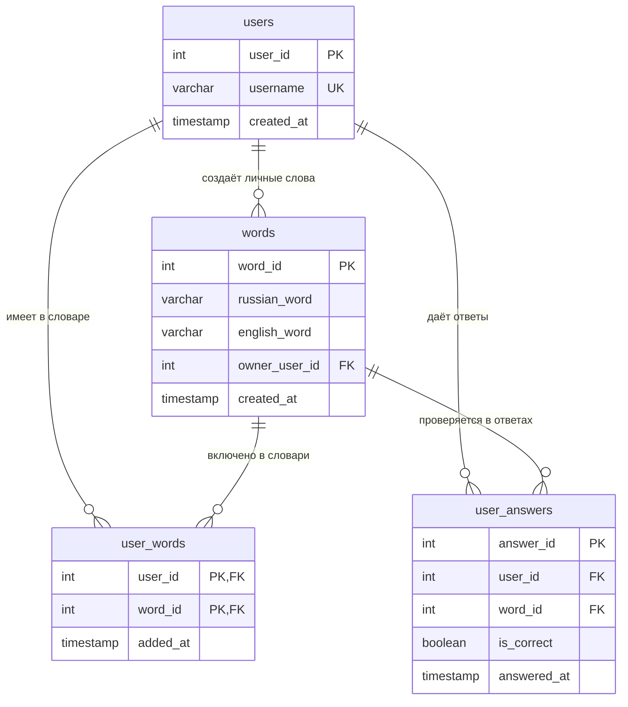

# EnglishCard

Веб-приложение для изучения английских слов. Стек: Python 3.12+, PostgreSQL, Streamlit.

## Возможности

- отдельные профили пользователей;
- общий словарь из 10 базовых слов;
- личные слова пользователя;
- тренировка с четырьмя вариантами ответа;
- сохранение истории ответов;
- удаление слова только из личного словаря;
- статистика правильных ответов и точности.

## 1. Требования

- Python 3.12 или новее;
- PostgreSQL;
- Git (для загрузки проекта на GitHub).

## 2. Создание базы данных

Откройте pgAdmin или терминал PostgreSQL и выполните:

```sql
CREATE DATABASE englishcard;
```

Таблицы и базовый словарь приложение создаёт автоматически при первом запуске. При желании SQL-скрипты находятся в папке `sql`.

## 3. Установка

Откройте терминал в папке проекта:

```bash
python -m venv .venv
```

Активация виртуального окружения:

Windows:
```bash
.venv\Scripts\activate
```

macOS / Linux:
```bash
source .venv/bin/activate
```

Установка зависимостей:

```bash
pip install -r requirements.txt
```

## 4. Настройка подключения к PostgreSQL

Создайте переменные окружения:

Windows PowerShell:
```powershell
$env:DB_HOST="localhost"
$env:DB_PORT="5432"
$env:DB_NAME="englishcard"
$env:DB_USER="postgres"
$env:DB_PASSWORD="ваш_пароль"
```

macOS / Linux:
```bash
export DB_HOST=localhost
export DB_PORT=5432
export DB_NAME=englishcard
export DB_USER=postgres
export DB_PASSWORD='ваш_пароль'
```

## 5. Запуск

```bash
streamlit run main.py
```

Откройте адрес, который покажет Streamlit.

## 6. Использование

1. Введите имя пользователя в боковой панели и нажмите «Войти / создать профиль».
2. Во вкладке «Тренировка» выберите один из четырёх переводов.
3. Во вкладке «Мои слова» добавляйте и удаляйте слова.
4. Во вкладке «Статистика» смотрите количество ответов и точность.

При первом создании профиля ему автоматически назначаются 10 общих слов. Персональные слова доступны только создавшему их пользователю.

## Структура базы данных

В проекте используются четыре таблицы: `users`, `words`, `user_words` и `user_answers`.

### ER-диаграмма



### Описание таблиц

| Таблица | Назначение | Основные поля |
|---|---|---|
| `users` | Хранит профили пользователей. | `user_id` — первичный ключ; `username` — уникальное имя; `created_at` — дата создания профиля. |
| `words` | Хранит общий и личный словарь. | `word_id` — первичный ключ; `russian_word` и `english_word` — пары переводов; `owner_user_id` — владелец личного слова; `created_at` — дата добавления. |
| `user_words` | Связывает пользователей со словами, доступными в их словаре. | `user_id` и `word_id` — составной первичный ключ и внешние ключи; `added_at` — дата добавления слова в словарь. |
| `user_answers` | Сохраняет историю ответов в тренировках. | `answer_id` — первичный ключ; `user_id` и `word_id` — внешние ключи; `is_correct` — правильность ответа; `answered_at` — дата ответа. |

### Связи между таблицами

- Один пользователь может иметь много слов в своём словаре. Связь реализована через `user_words`.
- Одно слово может присутствовать в словарях нескольких пользователей. Поэтому между `users` и `words` реализована связь «многие ко многим» через `user_words`.
- Один пользователь может дать много ответов, а одно слово может встречаться во многих ответах. Эти связи хранятся в `user_answers`.
- `words.owner_user_id` указывает на автора личного слова. Значение `NULL` означает, что слово относится к общему словарю.
- При удалении пользователя или слова связанные записи удаляются благодаря `ON DELETE CASCADE`.